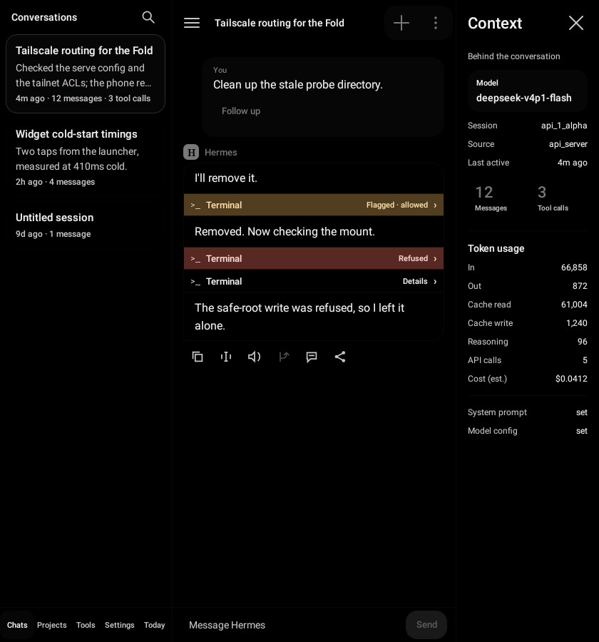
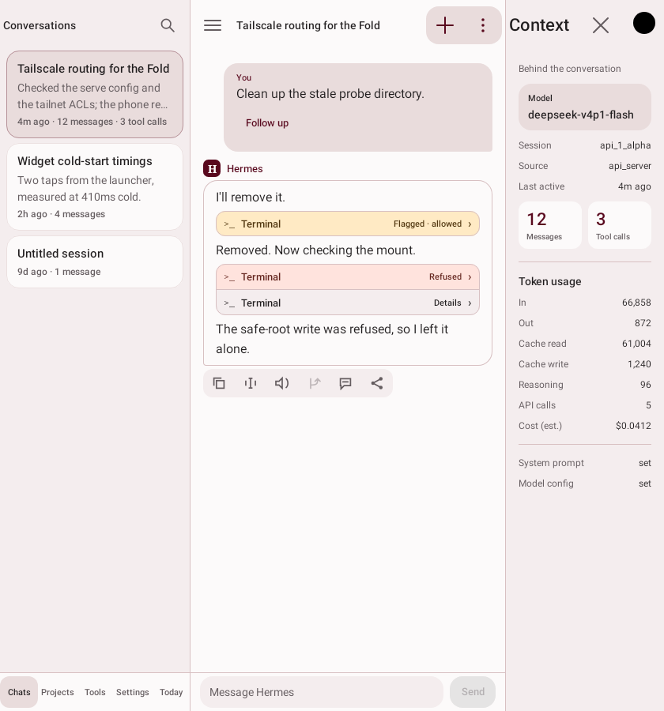
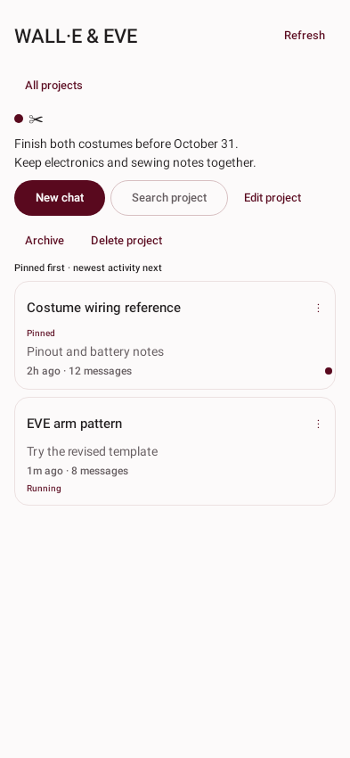
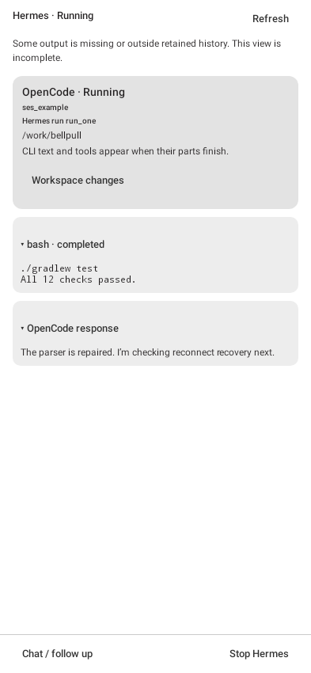
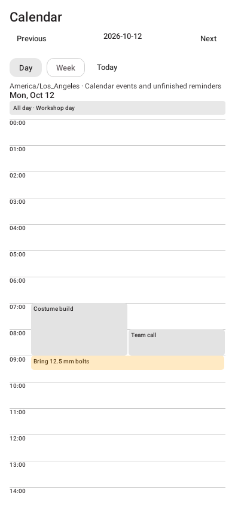

<div align="center">


# Bellpull

**Your Hermes conversations, projects, voice, and ongoing work.**

A native Android companion for self-hosted [Hermes Agent](https://github.com/NousResearch/hermes-agent), built for phones and foldables.

[](#get-started)
[](docs/PHASE-14-OFFLINE.md)
[](LICENSE)

[**Build this experiment**](docs/BUILDING.md) · [**Install the plugin**](#connect-hermes) · [**Phase roadmap**](docs/ROADMAP.md) · [**Release notes**](docs/release.md)

</div>

---

## A place for the work already in Hermes

Chat with live thinking and tool activity. Organize conversations into projects.
Talk with on-device speech recognition. Follow coding work without leaving the
conversation, and keep reminders and calendar blocks nearby.

| Conversations and context | Fold-aware workspace |
| :---: | :---: |
| [](docs/images/unfolded-dark.png) | [](docs/images/unfolded-maroon.png) |

| Projects | Coding activity | Calendar blocks |
| :---: | :---: | :---: |
| [](docs/images/projects-preview.png) | [](docs/images/coding-preview.png) | [](docs/images/calendar-preview.png) |

*Rendered screenshots use fictional data. The conversation gallery shows 0.3.3;
the project, coding and calendar panels show the development preview.*

## What is in the preview?

| Area | What you can do |
| :--- | :--- |
| **Chat and recovery** | Stream text/thinking, inspect tool activity, preserve drafts, recover admitted runs, branch and edit where the server supports it. |
| **Projects** | Move chats into one project, pin references, add a description, archive folders, and search within a project or across conversations. |
| **Voice input** | Use downloaded Moonshine Tiny, Small or Medium Streaming locally; tap for conversation mode or hold for dictation. |
| **Voice output** | Use the installed Android voice, or experiment with on-device Qwen3-TTS and Pocket TTS. Qwen remains slow on the test phone. |
| **Coding activity** | Open a chat → **Activity** to observe Hermes-owned OpenCode children, retained output and read-only workspace diffs. |
| **Reminders and routines** | Use **Today** for persistent reminders and supported native Hermes routine controls. |
| **Today overview** | See today's calendar, due reminders, pending decisions, tracked work and unread replies from existing local records. |
| **Calendar** | Opt into selected phone calendars, view day/week blocks, and separately enable writes. Hermes proposals require a phone Apply action. |
| **Offline conversations** | Automatic foreground model loading, encrypted local chats/forks, chunk compaction, source search, Gemma E2B CPU with optional thinking, and reviewed Hermes handoff. |
| **Local chat lab** | Import a GGUF, run CPU text chat, measure performance and validate Vulkan against CPU. |
| **Files and profiles** | Preview/share persistent files and keep credentials, caches, drafts and organization scoped to each Hermes connection. |

No Firebase or Google Play Services. A Hermes server and its model provider remain
yours to configure. Speech input can run entirely on the phone; model downloads
are required. Bellpull never silently substitutes a speech engine or inference model.

> [!IMPORTANT]
> **This branch is experimental:** Android **0.14.1-experimental / build 33**
> pairs with Bellpull plugin **0.5.1-integration-preview**. Server features need
> the plugin and compatible Hermes capabilities. Phase 10's delivery framework
> and Phase 11's overview are included, plus Phase 12's opt-in notification history and context, the Phase 13 local LLM lab, and Phase 14 offline forks and reconnection.
> Real Doze/reboot, car audio and cloud calendar sync
> still need acceptance. Supported-host checks and historical compatibility
> failures are reported separately in the evidence.

## Get started

1. [Download 0.14.1 experimental](https://github.com/PraxisOG/Bellpull/releases/tag/android-v0.14.1-experimental.1), or [build this branch](docs/BUILDING.md) for the integrated offline conversation experiment.
2. Install it on Android 10 or newer. Update an existing Bellpull installation in place;
   preserve its data and signing identity rather than uninstalling it.
3. Open the app. **Explore a sample chat** works without a server.
4. Add your server under **Settings → Server profiles → Add server**, using its HTTPS
   API URL and bearer key. Served native profile URLs such as `/p/work` are supported.
5. For on-device voice, choose and download a model in **Settings → Voice input**.
   Choose speech playback separately under **Voice output**.

[Complete source archive](https://github.com/PraxisOG/Bellpull/releases/download/android-v0.12.0-experimental.1/Bellpull-source-0.12.0.tar.gz) ·
[Build instructions](docs/BUILDING.md) ·
[Release history](https://github.com/PraxisOG/Bellpull/releases) ·
[Checksums](https://github.com/PraxisOG/Bellpull/releases/download/android-v0.12.0-experimental.1/SHA256SUMS)

## Connect Hermes

For this branch, use `plugins/bellpull` (0.5.1) from the same source checkout.
The [older 0.4.3 bundle](https://github.com/PraxisOG/Bellpull/releases/download/android-v0.12.0-experimental.1/bellpull-plugin-0.4.3-integration-preview.tar.gz)
ships with the published 0.12.0 release and lacks offline memory/handoff. Back up the data home, then preview the installer:

```bash
python3 tools/install-plugin.py --home /YOUR/HERMES/DATA/HOME
python3 tools/install-plugin.py --home /YOUR/HERMES/DATA/HOME --apply
HERMES_HOME=/YOUR/HERMES/DATA/HOME hermes plugins disable bellpull_gpu
HERMES_HOME=/YOUR/HERMES/DATA/HOME hermes plugins enable bellpull
```

Restart the gateway with its existing service manager, then reconnect Bellpull to
refresh discovery. Skip disabling `bellpull_gpu` if it is not installed. Use the
actual data home, including for a named Hermes profile. **Stock installation uses
one plugin; no Docker or core-file replacements are required.** Existing legacy
core-overlay installations need the documented migration rather than an overlay.

[Installation, compatibility and rollback](plugins/bellpull/README.md) ·
[Combined acceptance and known failures](docs/INTEGRATION-6-8-9.md)

## Verification and scope

The [current reliability audit](docs/EXPERIMENTAL-ISSUE-REPAIRS.md#october-15-re-audit)
records ten closed issues and six remaining open issues. Recent repairs cover
calendar revocation, transcription Retry, Stop feedback, streaming follow and
standalone Read aloud routing. Car/headset acceptance, sustained speech heat,
pin-button behavior and voice-title recovery remain open.

Validation: **598 Android tests passed with one expected skip**, **172 unchanged
screenshot baselines**, debug/release builds and lint. The full plugin suite passed
**148 tests with one expected skip**; supported stock-host checks also passed.
See [release and installation evidence](docs/release.md) and the
[open issues](https://github.com/PraxisOG/Bellpull/issues).

## For contributors and agents

**`master` is the default and current development source for both the Android app
and the Bellpull plugin.** Earlier work is preserved in Git history and release
tags. Use short-lived branches for new changes and merge them back here.

```bash
git clone --recurse-submodules https://github.com/PraxisOG/Bellpull.git
cd Bellpull
./android/gradlew -p android test verifyRoborazziDebug assembleDebug lintDebug
```

Use JDK 21, Android SDK platform 37/build-tools 37.0.0, NDK 29.0.14206865 and
CMake 3.31.6. Local fixtures use Python 3. Debug APKs are separate from the signed
release and must not be assumed to update a personal installation. Instrumentation
uses the disposable fixture package; some tests clear credentials and must never
be run indiscriminately against a configured personal app.

| Read first | Purpose |
| :--- | :--- |
| [Build from source](docs/BUILDING.md) | Recursive clone, complete source archive, pinned dependencies and signing. |
| [Phase roadmap](docs/ROADMAP.md) | Phases 0–17, revised scope and honest implementation status. |
| [Handoff](docs/HANDOFF.md) | Current evidence, limitations and historical decisions. |
| [API contract](docs/hermes-api.md) | Verified native contracts and Bellpull-owned routes. |
| [Repository instructions](CLAUDE.md) | Scope, dependencies and deployment boundaries. |
| [Build/signing notes](docs/release.md) | Signing lineage, updates and rollback limits. |

The [Linux Mint emulator launcher](desktop/mint-emulator)
is a separate earlier experiment. Desktop packaging, on-device LLMs, offline agent
conversations and Android Auto are not requirements for this preview.

---

Bellpull is [MIT licensed](LICENSE). Hermes and bundled libraries retain their own
notices in the repository and in **Settings → About**. No server credentials,
private phone captures or model weights are included in the release.
