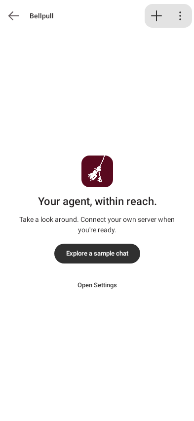
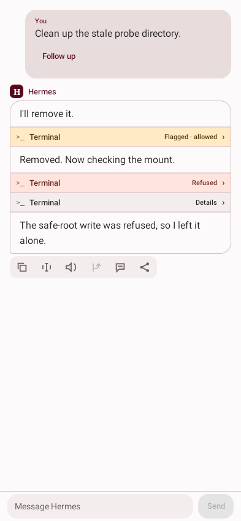
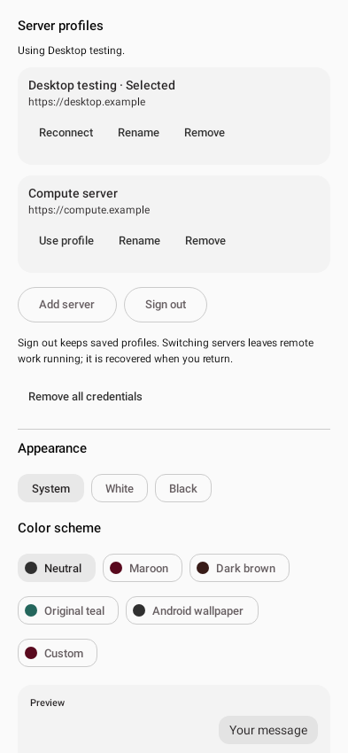

# Bellpull — Hermes Android

**[Download Bellpull 0.3.3 for Android (.apk)](https://github.com/PraxisOG/Bellpull/releases/download/android-v0.3.3-preview.1/Bellpull.apk)** · [Release notes and checksum](https://github.com/PraxisOG/Bellpull/releases/tag/android-v0.3.3-preview.1)

## Try it on your phone

1. Download **Bellpull.apk** on an Android 10 or newer phone.
2. Open the download and allow your browser or file manager to install this app if Android asks.
3. Open **Bellpull** and tap **Explore a sample chat**. No account or server connection is required.
4. When you want to connect an agent, open **Settings → Server profiles → Add server**.
   Enter a profile name, your Hermes API server URL and API key, then tap **Save and connect**.
   Settings is also available from the chat's three-dot menu.

The sample conversation is local and fictional; it does not run an LLM or contact
an agent. You can explore the layout, copy/read sample messages and change appearance.
No agent, server account or API key is included. This development preview is signed
with the project's current debug certificate; it can update the matching development
build without uninstalling it. Existing connections migrate into an **Existing server**
profile with their local chats and drafts preserved.

Use a reachable HTTPS URL, or your server's Tailscale address. Optional Bellpull
features use the [Bellpull plugin](plugins/bellpull/README.md); the app checks
what your server supports. Source/build details follow below.

A native Android chat client for a self-hosted [Hermes Agent](https://github.com/NousResearch/hermes-agent), built with Kotlin and Jetpack Compose. Designed for compact, adaptive conversation layouts on a Pixel Fold running GrapheneOS, without Firebase or Google Play Services.

## A look inside

Foldable layouts, compact message controls, light and dark themes, and optional server
profiles. These screenshots are rendered from Bellpull 0.3.3 using fictional chats
and example server addresses. Click any image to view it at full size.

| Maroon · unfolded with camera cutout | Black · conversations, chat and context |
| :---: | :---: |
| [](docs/images/unfolded-maroon.png) | [](docs/images/unfolded-dark.png) |

| Explore without connecting | Compact message controls | Server profiles and themes |
| :---: | :---: | :---: |
| [](docs/images/welcome.png) | [](docs/images/message-controls.png) | [](docs/images/server-profiles.png) |

## Current state

This local-voice development branch builds **0.5.4 (code 16)**. Settings →
**Voice output** offers the default installed Android voice or an experimental
on-device Qwen3-TTS CPU voice, with verified model downloads and tuning. Qwen
requires 859.85 MB of weights and is currently slow on the Fold; Android voice
remains the default. See [output setup and measurements](docs/VOICE-OUTPUT.md).
The signed APK is ready locally; **the personal phone still has 0.5.3**, because
ADB disconnected before installation. Nothing in this slice has been pushed.

The existing voice-input implementation It adds Moonshine
Tiny, Small and Medium Streaming on-device CPU transcription, collapsible Settings
categories, and model downloads/load/unload/delete controls. Choose **On device**
in Settings → Voice input; model experiments and direct-WAV benchmarks are under
**Voice input → Experimental**. A downloaded model needs no transcription URL or key.
All three models completed direct-input phone benchmarks and sustained thermal
tests. Start voice is disabled until the selected local model is installed;
missing/incomplete files are checked again before permissions, service startup and
recognizer creation. Open Voice settings and download
a model in the personal app. See [measured results](benchmarks/speech/pixel-10-pro-fold-2026-10-11/README.md)
and [setup and limits](docs/LOCAL-SPEECH-LAB.md).

Tap the microphone to start/end conversation mode; its filled button pulses while
voice is on. Hold, wait for the ready chime, speak and release to dictate into the
message draft. Settings → Voice input has a short **Using voice** guide and an optional
**Debugging voice interface** toggle for the previous detailed panel. Voice prompts
request one paragraph, minimal reasoning and a purpose before each tool/search;
provider thinking controls remain unchanged. Bellpull reads genuine activity statuses
and requests chat Stop after recognizing non-echo user speech during a reply.
See [voice behavior and limits](docs/PHASE-5-VOICE.md).

The Phase 5 foundation adds a service-owned
conversational voice preview with optional private WAV transcription, installed offline
speech, review/hands-free/push-to-talk modes, streaming sentences and recovery.
Private-server mode requires your own service configuration; it is never an automatic
fallback from local recognition. See [voice setup, limits and acceptance](docs/PHASE-5-VOICE.md).
The drawer now groups project/source choices in the filter icon left of Search,
uses two-line compact titles and removes API/CLI/TUI badges from chat rows.
This is a development preview, not a new public release.

The Phase 4 foundation builds **0.4.0 (code 11)** with **Bellpull plugin
0.3.0**. Projects provide shared folder metadata, single membership, pins,
archive/restore, a description and scoped search. Settings → About shows the
actual installed app version and each saved server's last reported plugin version.
The signed update passed isolated Fold acceptance and was installed over 0.3.7.
This is a development branch, not a new public release. See
[the Phase 4 scope and acceptance checklist](docs/PHASE-4-PROJECTS.md).

The repair branch builds **0.3.7 (code 10)** with **Bellpull plugin 0.2.2**:
completion recovery after compaction, retrying failed initial streams, bounded
file staging, compression-aware file membership, native profile URLs and repaired
Android CI setup. See the [audit repair report](docs/AUDIT-0.3.6-REPAIR.md) for
regression evidence and stock-install acceptance steps. It also includes stock
JSON-named SSE frames, all native conversation sources by default, live reasoning, an animated working row
inside the response, native CommonMark rendering with code
copy, dense/title-only navigation defaults, optional larger labeled controls,
source-scoped history and complete paging, Info labels, artifact lifecycle controls
and bounded run-journal retention. A single Bellpull plugin provides stock Hermes
file sharing and live thinking. The pinned host extension is optional legacy
compatibility for run inputs/model overrides. The public download and gallery above remain 0.3.3.
The personal server migration remains a manual user action; see
[handoff](docs/HANDOFF.md), [plugin setup/rollback](plugins/bellpull/README.md),
[API contract](docs/hermes-api.md), and [release signing](docs/release.md).

Bellpull Phase 2 is implemented: streaming conversations, compact tool/thinking rows, searchable history, context panels, message copying and read-aloud, selected-message branching, prompt editing, themes and Android wallpaper colors. Durable runs recover from disconnects and app restarts; unread conversations rise to the top. Optional ntfy-backed notifications and exact-request tool approvals use the accompanying server extensions.

Phase 2 also includes encrypted named server profiles, switching, sign-out and removal
of saved credentials. Chats, drafts, unread state and run recovery are isolated by profile.
New installations open a useful disconnected workspace with optional setup in Settings.

Phase 3 adds configured model selection in Info, supported reasoning controls,
per-profile defaults for new chats, file/image selection and camera capture, persistent
uploads with retry/cancel, native PDF/image previews, a Tools attachment browser, and
Android share-in/share-out. Generated files use the same authenticated records as
uploads. Files appear as compact conversation artifacts with filename, Download and
View actions. View opens a rounded preview dialog with scrolling, fit/zoom, PDF page
navigation, Open/Save/Share, and an optional right drawer for side-by-side reading.
The Bellpull plugin includes GPU telemetry that reads local
AMD/NVIDIA temperatures on the Hermes host; no SSH or model call is needed.

The old [Phase 3 extension](server-patches/bellpull-phase3/README.md) remains the
production rollback until the new plugin is accepted.
Model availability and vision/reasoning depend on the configured backend. The verified
local Qwen route supports thinking On/Off, not graded effort. GPU cards appear only
when the plugin can read actual hardware; missing tools/sensors show unavailable.

Each Hermes response now shares one outlined bubble across its text, thinking,
tool calls and generated artifacts. Tool and file rows reach the bubble edges,
sharing its outline and outer corners. **Settings → Dense chat window** hides speaker
names and permanent action bars; long-press a bubble for its actions. Copy and Select
text cover the response's prose, while tool rows retain their own details and data.
The chat's three-dot menu includes **View artifacts**. Android Back returns from
Settings to your chat and closes an open conversations panel before leaving the app.

Today remains a placeholder page. Settings include experimental immersive
mode with camera-cutout-aware headers. Side panels slide in 180ms unless Reduce motion
or Android's animation settings disable motion. See the handoff for physical-versus-rendered coverage.

Phase 3 validation includes JVM/screenshot checks, APK/lint, isolated real-adapter
tests, Android content-provider imports, failed-upload retry, native PDF/image previews,
camera capture and an actual Sharesheet recipient with read-only grants. A live Hermes
test identified an uploaded image, read a PDF and generated a new downloadable PDF.
See [the handoff](docs/HANDOFF.md) for exact counts, phone acceptance, advisory lint
warnings and remaining hardware/network limits. The gallery above shows the 0.3.3 UI;
its [source list](docs/images/README.txt) is included. No private phone screenshots are published.

## Build and test

For the experimental Linux Mint launcher that runs a Bellpull APK in an isolated
Android emulator, see [desktop/mint-emulator/README.txt](desktop/mint-emulator/README.txt).
It builds a `.deb` and portable archive, keeps its own Android data and never targets
a connected phone. This is a desktop preview; a native Compose Desktop port remains
future work. Its existing packaged release contains the earlier 0.1.0 phone preview;
the Android download above contains the current phone update. Desktop packaging is
parked while Android development continues.

Requires JDK 17, Android SDK Platform 37, NDK 29.0.14206865, CMake 3.31.6, Python 3 for the local HTTP fixtures, and network access to download Gradle dependencies. Set `ANDROID_HOME` to your SDK directory or create an untracked `android/local.properties` containing `sdk.dir=/absolute/path/to/Android/Sdk`.

Initialize pinned native sources and run from the repository root:

```sh
git submodule update --init --recursive
./android/gradlew -p android test verifyRoborazziDebug :app:assembleDebug :app:lintDebug
```

The APK is written to `android/app/build/outputs/apk/debug/app-debug.apk`. These checks run locally without a phone or live inference; the live smoke test is opt-in. Device instrumentation includes a credential-clearing test and should not be run indiscriminately on a configured personal phone.

Android 10 (API 29) is the minimum supported version; the current target is API 37. Release signing is optional and configured through ignored `android/keystore.properties` and your own keystore. A release build without those credentials is unsigned.

## Connect a server

Open **Settings → Server profiles → Add server** and enter a name, reachable Hermes API
URL and bearer key. The verified deployment uses Tailscale; provide your own server
access and credentials. Keys are stored through Android encrypted preferences and
are never part of this repository.

Save separate profiles for a desktop test server and a compute server, then tap
**Use profile** to switch. **Sign out** returns to the disconnected workspace while
keeping saved profiles. **Remove** deletes one profile; **Remove all credentials**
deletes all saved server URLs, keys and local account data, including cached chats,
drafts and recovery records. Neither option deletes remote chats or revokes server
keys. Switching or signing out leaves remote work running; saved profiles recover
their work when selected again. Notifications follow the active profile.

[docs/hermes-api.md](docs/hermes-api.md) is the API contract. Some features require the capability-gated extensions in [server-patches](server-patches/README.md); they are not assumed to exist in an arbitrary upstream Hermes installation. The patches include their tested base versions, build order, isolated tests and deployment caveats. No live server configuration or credentials are included.

## Where to start

- [docs/HANDOFF.md](docs/HANDOFF.md): latest implementation, verification and remaining work, followed by historical entries.
- [ROADMAP.md](ROADMAP.md) and [Bellpull-Implementation-Prompt.txt](Bellpull-Implementation-Prompt.txt): Bellpull direction and phased work. Later user refinements recorded in the handoff supersede the original brief.
- [CLAUDE.md](CLAUDE.md): repository conventions and constraints; older status sections should be read alongside the latest handoff.
- `android/app`: Compose UI, local state, recovery, notifications and Android services.
- `android/core-hermes` and `android/core-model`: HTTP/SSE client and shared data types.
- `mock-hermes`: local contract-test fixtures.
- `desktop/mint-emulator`: isolated Linux Mint emulator launcher, packaging and smoke fixture.
- `server-patches`: versioned server extensions needed by the current client.
- `phone-ping-plugin` and [ROADMAP-TIER2.md](ROADMAP-TIER2.md): the older phone-bridge track, separate from Bellpull Phase 2.

The upstream Hermes code included under `server-patches` retains its [MIT notice](server-patches/LICENSE.hermes-agent). No project-wide open-source license has been selected for the app.
