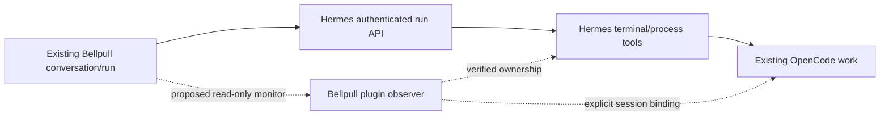

# Phase 6 prelim: monitor OpenCode through Hermes

Branch `feature/phase6-opencode-activity`, based on Phase 5 offline commit
`c5dceec`. **Preliminary, not an enabled integration.** No personal server access,
phone access, OpenCode execution, inference, plugin deployment or push. The user
asked for implementation without further tests; only compilation/source inspection
was performed for this preliminary work. On October 12, the user requested and
received the separate Phase 5 **0.5.5/code 17** update; this Phase 6 prototype was
excluded. See [installation evidence](HANDOFF.md).

## Scope and first slice

The October 11 roadmap defines a coding/activity view of the existing Hermes
conversation and run. The user clarified that Hermes uses OpenCode and that
OpenCode is what we should monitor. Keep the existing session/project navigation,
drafts, run journal, approvals and Stop. A coding view must show the distinction
between the Hermes coordinator and its OpenCode work, with expandable plain-text
command output and honest connection/waiting states. Workspace identity and
read-only diffs follow. No separate agent runner, generic terminal, mobile IDE,
automatic worktrees, new coding provider or blanket permissions.

Added a transport-independent Kotlin prototype in
[OpenCodeActivity.kt](../android/core-model/src/main/kotlin/org/praxisog/hermes/model/OpenCodeActivity.kt): explicit profile/Hermes run/session/
OpenCode session/process/workspace binding, bounded CLI JSON-line decoding and a
bounded timeline with part-ID replacement. It has no network/command/control path
and is not connected to the app. Synthetic fixtures are under
`docs/phase6/fixtures/`; they are constructed from source schemas, not live captures.
No new dependency or Hermes endpoint was added. `:core-model:compileKotlin` and
`:app:assembleDebug` pass;
regressions and phone acceptance have not run.

## Source findings

| Evidence | What it establishes | What it does not establish |
| --- | --- | --- |
| Existing [Bellpull contract](hermes-api.md), StreamEvent/RunStatus/Message/ToolResult | Hermes run lifecycle, replay/reconciliation, genuine approvals where supported, tool status and persisted tool results | OpenCode session binding, full live subprocess output, workspace/file-diff authority |
| [Hermes OpenCode skill](https://github.com/NousResearch/hermes-agent/blob/d4d2ab7b5d104166e7e22a02cafd12f1fe456a31/skills/autonomous-ai-agents/opencode/SKILL.md) | Hermes can invoke the CLI through terminal/process tools, including background PTY and structured JSON output | Which invocation/version/configuration the personal server uses |
| [Hermes process registry](https://github.com/NousResearch/hermes-agent/blob/d4d2ab7b5d104166e7e22a02cafd12f1fe456a31/tools/process_registry.py) | Process ownership/task/session context, cwd, rolling output and exit observations exist internally | A supported authenticated mobile API or a durable lossless replay feed |
| [OpenCode 1.19.0 CLI](https://github.com/anomalyco/opencode/blob/733b2c627e5aec39cb33cc22373bdce33053ef2c/packages/opencode/src/cli/cmd/run.ts) | JSON lines include timestamp/sessionID and selected completed parts | Live token/tool-start deltas, resumable cursors, interactive questions or final-run evidence in that output |
| [OpenCode server docs](https://opencode.ai/docs/server/) | A separate OpenCode server can expose session messages, events and diffs | That Hermes launched one, that a separately started server owns the existing work, or that the phone should connect directly |

The stock Hermes disposable source checkout is pinned to
`d4d2ab7b5d104166e7e22a02cafd12f1fe456a31`; tracked files are unmodified.
OpenCode source was checked at released **v1.19.0**, commit
`733b2c627e5aec39cb33cc22373bdce33053ef2c`. Current main was also located but is
already reorganizing package paths; do not design a versionless adapter around it.
Nothing here establishes the user's installed versions.

Important source details:

- Hermes process IDs (`proc_…`), Hermes conversation/run IDs and OpenCode session
  IDs (`ses_…`) are separate. An OpenCode provider/relay header is also unrelated
  to the coding CLI session. Never match by title, cwd alone, PID alone or by
  finding the word OpenCode in a terminal command.
- CLI JSON mode emits tool parts after completion/error and text after its part
  finishes. A step finishing is not the whole task finishing. EOF, lost connection,
  empty output or a Hermes coordinator completion do not prove its child stopped.
- In the checked non-interactive CLI, permission requests are rejected unless an
  explicit automatic mode changes that behavior. Permission warning text may
  appear beside JSON lines. Do not render it as an actionable pending approval or
  enable automatic permissions to make monitoring convenient.
- The process registry has a single `on_output` sink. Replacing it would steal
  another consumer's events. Its rolling tail can lose earlier data. A future
  observer needs compatible composition, retention and lifecycle cleanup; it
  cannot advertise lossless replay merely by polling the tail.
- Newer stock source includes bounded tool-completion previews. That is source
  evidence of upstream drift, not a verified change to Bellpull's documented
  installed-server contract or a substitute for complete command output.
- Run Stop in the inspected Hermes source tracks and reaps owned processes using
  ownership/epoch evidence. Older builds/remote backends may differ; current
  Bellpull Stop remains the only enabled control. Do not advertise that it kills
  every OpenCode child on the personal host before verification.

## Proposed host bridge, not a current API

Use the Bellpull plugin as the authenticated boundary if a live bridge is added.
The phone keeps the selected Hermes URL/native-profile prefix and bearer auth.
OpenCode credentials/endpoints stay host-side. No second phone login, public
OpenCode port, SSH requirement or Docker/core-module replacement.

Before defining HTTP routes or advertising capabilities, verify these contracts in
a disposable host matching the user's versions:

1. **Binding and isolation.** Capture the launch's Hermes run/conversation and
   owning task, process incarnation, explicit OpenCode session and real workspace.
   Persist a versioned binding; scope it to the authenticated native Hermes
   profile. Device cache is additionally scoped to its saved connection. Preserve
   legitimate compression identity without attaching work to an ordinary branch.
2. **Observation.** Prefer events/messages from the actual OpenCode instance when
   it exists. For CLI JSON launches, retain structured output and explicitly report
   its reduced fidelity. Existing PTY/TUI work may only have text tails; display
   that limitation. Never rerun/admit work to obtain a richer monitor.
3. **Recovery.** Host-assigned durable event IDs, bounded retention, authoritative
   snapshots and explicit replay gaps. Separate parent run, child process, child
   session and connection state. On gateway restart, verify process incarnation;
   disappearance becomes unknown/lost, not success. No duplicate inference.
4. **Requests and controls.** Bind real approvals/questions to the exact source,
   session, request ID and lifetime. Hermes approval IDs cannot be sent to
   OpenCode. Until this is verified, only existing Hermes controls are available.
   Follow-ups use the existing chat after settling; in-flight steering stays absent
   unless there is a verified implementation. Reopening must not replay a reply.
5. **Workspace and diffs.** Server-returned, authorized workspace IDs, no arbitrary
   client filesystem path. Keep reads inside the resolved root, including symlink
   checks; bound content/diff bytes, file count and duration. Treat binary/large/
   missing/non-Git files explicitly. No write, restore, revert or shell endpoint.
   Diff commands must disable external diff/textconv and use fixed argv/literal
   paths. Workspaces may contain other actors' edits: label those **Workspace
   changes**. Even an OpenCode session snapshot is not exclusive attribution.
6. **Compatibility and cleanup.** Feature-detect supported hooks/API versions,
   share observers without clobbering sinks, remove subscriptions on shutdown,
   and visibly report unavailable features. Native profile rejection must never
   fall back to root. Keep portable plugin registration; no core patch deployer.

Detailed proposed contracts deliberately remain undecided. There is no verified
current endpoint for this in `hermes-api.md`; no guessed path was added to client
or plugin. The existing plugin remains **0.3.0**.

## Prototype limitations and next checks

The prototype accepts only the source-checked CLI envelope; SSE and the newer
OpenCode V2 message schema need separate adapters. It refuses other sessions,
malformed/type-mismatched lines and excessive nesting. Output/detail and retained
rows are bounded; truncated/evicted/ignored/invalid data are counted. IDs replace
existing rows in the retained window; this is not a durable replay guarantee.
Reasoning stays a separate kind for future collapsed display. No raw output is
logged by model `toString`. No text becomes a tool command or approval action.
Connection loss discards a partial line and marks continuity lost; it never marks
a task finished. Profile isolation depends on a separately instantiated, verified
binding and a future authenticated host implementation, not the session string alone.

Resume with pure-model regressions for split/coalesced lines and Unicode, CRLF,
wrong nested/session IDs, duplicates/updates, excessive input, bounded eviction,
malformed permission text, lost partial lines, step-finish versus task completion,
and same OpenCode ID under separate profiles. Then exercise a disposable Hermes +
OpenCode host for process/run binding, real child states, Stop, genuine requests,
restart/replay and workspace read containment. No provider/phone check is claimed.

Manual acceptance once implemented:

- From a Hermes chat, start one normal OpenCode task. Open activity without starting
  another run; identify the coordinator, child, workspace and actual backend version.
- Expand command output, switch chats/projects, background/reopen and disconnect/
  reconnect. Preserve drafts, run identity and chronology; show any replay gap.
- Observe a real wait/request; answer once on the exact source. Test denial and
  expired requests. Confirm plain CLI warning text never gains approval buttons.
- Stop from Bellpull and check both coordinator and child. If child-stop is not
  proven, show its state honestly. A follow-up admits exactly once after settlement.
- Inspect text/binary/large/untracked changes read-only. Edit the same workspace
  outside the run and confirm the app labels shared workspace changes honestly.
- Check another profile, an ordinary branch and a compressed continuation. Work
  and files remain associated only with their verified owner/lineage.

Phase 5 lives independently on `feature/local-voice-models`; its untested offline
changes and device cleanup are in [VOICE-OUTPUT.md](VOICE-OUTPUT.md). Neither branch
has been pushed. Do not install this preliminary branch as a verified update.
