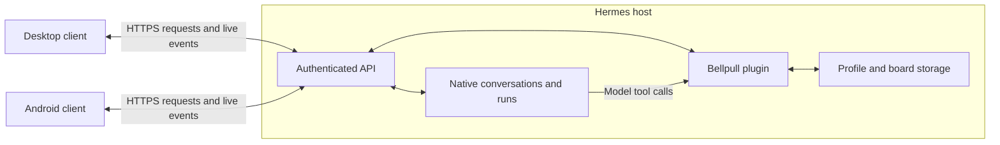

# Unified Bellpull client and plugin plan

Status: **Forward-looking proposal**, November 1, 2026.

Bellpull should have one server contract and one plugin package serving both its
Android and desktop clients. Connecting both apps to the same Hermes host and
profile should expose the same conversations, canvases, files and planning data.
Native Kanban boards retain their existing installation-wide ownership. Each
client keeps its own interface, drafts, caches and device integrations.

Unifying the product and eventually its repository is worthwhile. The first
investment should be the shared contract, recovery behavior and compatibility
tests; repository consolidation can follow without delaying desktop parity.
Plugin deployment and repository migration remain future work. The current
priority stays desktop development, with phone-specific functions on the phone
and calendar behavior following the existing mobile plugin contract.

## Current foundation

The experimental mobile source includes Android 0.19.0/build48 and plugin
0.8.2-canvas-v1-preview following [the shared Canvas merge](https://github.com/PraxisOG/Bellpull/pull/44).
The published 0.18.2 assets remain a separate release. Desktop 0.7.0 adds native
Kanban to its shared canvas, Files, model controls and Moonshine Medium/Kokoro
speech work; its development changes are in
[desktop PR 1](https://github.com/PraxisOG/bellpull-desktop/pull/1).

The desktop test gateway uses an older plugin base with Canvas and Kanban added.
Its Canvas, Kanban, projects, planning and speech modules match the merged mobile
source. The merged source also contains phone-context support and newer model/
thinking fixes. The desktop client uses the same API routes; it does not require
a separate desktop-specific server plugin.

Canvas already has shared authoritative state, revision checks, durable operation
identities and streamed committed changes. Kanban already has atomic receipts,
offline queues and conflict review on both clients. Kanban currently refreshes
through HTTP reads; it has no shared live change feed. Remaining mobile Canvas
controls and conversation-screen acceptance stay tracked in
[issue 38](https://github.com/PraxisOG/Bellpull/issues/38).

## Host and client interface



The gateway retains native bearer authentication and optional `/p/{profile}`
scoping. Native Hermes owns conversation execution, model routing, cancellation
and supported approval handling. Bellpull adds its tools and resource APIs.
Clients discover capabilities before enabling a feature.

| Interaction | Existing interface |
| --- | --- |
| Discover supported features | `GET /v1/capabilities` and `GET /api/bellpull/capabilities` |
| Submit and follow an agent run | Native `POST /v1/runs`, status/stop routes and server-sent events where advertised; legacy streaming retains its narrower recovery guarantees |
| Read shared resources | Authenticated JSON snapshots for projects, canvas, tasks, files and planning |
| Apply resource edits | Validated mutations with operation identities and resource-specific revision checks |
| Receive canvas changes | Authenticated SSE carrying committed snapshots and ordered cursors |
| Use server speech | Speech endpoints accept audio/text and return transcription/audio; local speech can run on the client device independently |

For example, a client edits canvas revision 12. The plugin commits revision 13
and streams it to connected clients. An edit based on the old revision must be
reconciled. Model edits use the registered `bellpull_canvas` tool and the same
authoritative store. Clients render the result; zoom, selection and panel layout
can remain local.

The same plugin package can be installed on multiple Hermes hosts. Those hosts
retain separate data and execution authority. A unified repository or plugin
release does not establish board replication or automatic execution failover.

## What targeted plugin development can address

All six architectural challenges benefit from plugin work. Two are mainly server
work, three require coordinated client changes, and offline conversation handoff
is a larger joint project. This is an engineering assessment, not a completion
estimate; even the server-focused changes need client acceptance checks.

| Challenge | Plugin contribution | Required coordination |
| --- | --- | --- |
| Concurrent edits and reconnects | Consistent revision validation, durable receipts and recoverable event feeds | Clients retain request identities, detect gaps and present conflicts |
| Hermes compatibility | Centralized adapters, capability checks and a tested host-version matrix | Clients honor unavailable capabilities; some changes may require native Hermes support |
| Protocol drift | Versioned schemas, fixtures and compatibility rules | Kotlin and TypeScript adopt the contract and run the same behavioral cases |
| Server identity | Stable host/profile identities independent of network address | Clients associate aliases with the correct cache without mixing profiles or transferring queued writes |
| Device ownership | Device registrations, advertised abilities, consent state and action receipts | Devices enforce OS permissions, user approval and execution ownership |
| Offline LLM handoff | Conversation ancestry and repeat-safe import/handoff records | Clients provide branch review, context reconciliation and understandable handoff choices |

The first four offer the most immediate benefit to both clients. Canvas and
Kanban provide working patterns, but their recovery contracts differ; standardize
documented guarantees without replacing native run semantics or breaking existing
operation receipts.

## Proposed implementation order

1. **Contract and identity.** Publish schemas and shared fixtures for existing
   interfaces, including Unicode limits, exact large integers, error envelopes
   and feature versions. Specify stable installation/profile identity and verify
   it under authenticated connections. An identity response does not itself grant
   access. Address changes must preserve drafts and unresolved operations.
2. **Recovery consistency.** Specify how each mutation is admitted, recorded,
   looked up and retried. Persist receipt and resource mutation atomically where
   supported. Clients must never invent a new operation ID to recover an unknown
   outcome. Keep original draft revisions through background refresh.
3. **Shared change notifications.** Extend recoverable notifications to tasks,
   projects and planning. Define cursor scope, retention, reconnect and snapshot
   reset behavior. Replayed notifications update views; they never execute old
   commands. Existing clients can continue polling during adoption.
4. **Compatibility and paired acceptance.** Run plugin contracts against supported
   Hermes versions, then exercise Android and desktop against the same plugin
   artifact and fixture data. Test old-client/new-plugin combinations where the
   contract promises compatibility. Publish feature limitations explicitly.
5. **One canonical plugin release.** Package the combined implementation with
   documented migrations, backups and rollback. Deploy to the desktop test host
   first. Preserve stored identities and pending receipts. Moe updates remain
   user-managed under the current deployment arrangement.
6. **Device coordination and offline conversations.** Add these in separate
   increments after the shared foundation. Phone calendar writes still require
   the phone's permission and Apply flow. Offline conversation continuation needs
   explicit branch/handoff semantics rather than automatic transcript merging.

## Repository recommendation

Use **PraxisOG/Bellpull as the eventual home for the product**, while keeping the
Android and Electron clients independently buildable and releasable. One change
can then update a plugin contract, both clients, fixtures and documentation
together. Shared ownership should reduce drift without requiring a shared UI
framework or identical platform features.

A possible layout preserves the existing Android/plugin paths and distinguishes
the real desktop app from the older emulator experiment:

```text
android/                 Native Android client
desktop/app/             Electron desktop client imported with history
desktop/mint-emulator/   Existing earlier emulator experiment
plugins/bellpull/        Canonical Hermes plugin
contracts/bellpull/      Proposed versioned schemas and fixtures
contract-tests/          Proposed tests used by both clients and the plugin
server-speech/           Server speech service and shared protocol documentation
docs/                    Product roadmap and platform-specific acceptance
```

The repository merge should preserve desktop Git history, issue/PR references,
licenses and existing release links. The desktop speech helper and server speech
service need a compatibility audit before consolidating their implementation;
Android's native speech engines remain device components.

Build pipelines should select relevant paths so an Electron-only change does not
require a full Android native build. Android signing and desktop packaging remain
separate. Client and plugin version numbers need not match: publish compatibility
by protocol version and capabilities, with distinct release tags and artifacts.

The practical costs are a larger checkout, Android native submodules, CI setup,
release-script path changes and migration of issue ownership. Resolve those as a
bounded migration after the shared contract tests exist. Until then, keep both
repositories working and maintain links between related changes. No existing
plugin deployment or client repository needs to be retired to begin this plan.

## Acceptance for the shared architecture

- Both clients use the same plugin artifact on one host and observe the same
  existing conversation, canvas and task state within the intended scope.
- A lost response followed by client/plugin restart produces one mutation, with
  a recoverable outcome. Concurrent edits preserve work and expose conflicts.
- Stream gaps and retained-event expiry recover from authoritative snapshots;
  missed notifications never replay commands.
- A different address for the same host can be associated safely; a different
  host, profile or replaced board cannot inherit another authority's queued edits.
- Older supported clients still read data and disable unsupported operations
  without requiring lockstep app/plugin upgrades.
- Phone capabilities remain permission-controlled and device-owned. Local and
  server speech choices stay explicit, with no silent model substitution.
- Upgrades and rollback preserve conversations, credentials, drafts, canvas
  history, board identities and unresolved operation receipts.

Existing contracts remain authoritative until a proposed extension is implemented
and verified: [Hermes and Bellpull API](hermes-api.md),
[shared Canvas](SHARED-CANVAS.md), [native Kanban](PHASE-18-KANBAN.md),
[phone context and device actions](PHASE-15-ASSISTANT.md), and
[planning and calendar](PHASE-8-9-REMINDERS-CALENDAR.md).
